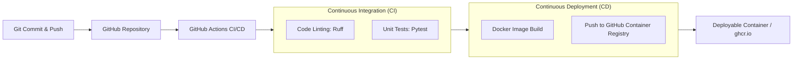

# Pre-trained ML Model Deployment with CI/CD

An end-to-end, production-ready implementation for serving a pre-trained **Hugging Face** Deep Learning model via **FastAPI**, containerized using **Docker**, and continuously integrated and deployed via **GitHub Actions**.

---

## 🇧🇩 শিক্ষককে কী দেখাবেন এবং প্রজেক্টের বিস্তারিত (বাংলা গাইড)

### ১. এই প্রজেক্টটি কেন তৈরি করা হয়েছে? (Why This Project?)
মেশিন লার্নিং বা ডিপ লার্নিংয়ে সাধারণত আমরা শুধু জুপিটার নোটবুকে মডেল ট্রেন করি। কিন্তু বাস্তব জগতে (ইন্ডাস্ট্রিতে) সেই মডেলকে ব্যবহারকারীদের কাছে পৌঁছে দেওয়ার জন্য একটি স্বয়ংক্রিয় সিস্টেম লাগে—যাকে বলা হয় **MLOps ও CI/CD (Continuous Integration & Continuous Deployment)**।

আপনার শিক্ষকের নির্দেশনা অনুযায়ী:
* স্ক্র্যাচ থেকে নতুন মডেল ট্রেন করার প্রয়োজন নেই; বরং Hugging Face-এর মতো প্ল্যাটফর্ম থেকে একটি প্রি-ট্রেইন্ড মডেল নিতে হবে।
* আসল ফোকাস হলো—সেই মডেলটিকে সফটওয়্যার ইঞ্জিনিয়ারিংয়ের আধুনিক স্ট্যান্ডার্ড (FastAPI, Docker, GitHub Actions) মেনে স্বয়ংক্রিয় পাইপলাইনের মাধ্যমে ডেপ্লয় করা।

---

### ২. শিক্ষককে প্রেজেন্টেশনে কী কী দেখাবেন? (Step-by-Step Demo)

#### 🔹 ধাপ ১: GitHub Actions-এর গ্রিন টিকমার্ক (Hero Moment)
শিক্ষককে আপনার রিপোজিটরির **Actions** ট্যাবে নিয়ে যান:
* দেখাবেন কীভাবে কোড পুশ করলেই স্বয়ংক্রিয়ভাবে দুটি কাজ হয়:
  1. **Lint & Test (CI):** কোডের কোনো ভুল বা বাগ আছে কিনা তা স্বয়ংক্রিয়ভাবে চেক করে।
  2. **Build & Push Docker Image (CD):** টেস্ট পাস হলে সাথে সাথে পুরো প্রজেক্ট ডকার কন্টেইনারে প্যাক হয়ে যায়।
* শিক্ষককে বলুন: *"ম্যাম/স্যার, আমাদের পাইপলাইনে যতক্ষণ না CI টেস্ট পাস করছে, ততক্ষণ ডকার বিল্ড শুরুই হয় না। ফলে কোনো বাগ প্রোডাকশনে যেতে পারে না।"*

#### 🔹 ধাপ ২: লাইভ প্রেডিকশন ডেমো (FastAPI Swagger UI)
ব্রাউজারে `http://localhost:8000/docs` খুলে সরাসরি টেস্ট করে দেখান:
1. **`POST /predict`** এ গিয়ে **Try it out** চাপুন।
2. একটি পজিটিভ বাক্য দিন:
   ```json
   {"text": "This automated deployment pipeline works brilliantly!"}
   ```
   **Execute** চাপুন। মডেল রেসপন্স দেবে: `POSITIVE` এবং স্কোর `0.9998`।
3. একটি নেগেটিভ বাক্য দিন:
   ```json
   {"text": "The build was broken due to unexpected bugs."}
   ```
   **Execute** চাপুন। মডেল রেসপন্স দেবে: `NEGATIVE` এবং স্কোর `0.9989`।

#### 🔹 ধাপ ৩: অটোমেটেড ইউনিট টেস্ট (Pytest)
টার্মিনালে কমান্ডটি চালিয়ে দেখান:
```bash
./venv/bin/pytest -v tests/
```
শিক্ষককে দেখাবেন যে কীভাবে মোট **৭টি টেস্ট কেস** (ইনপুট ভ্যালিডেশন, এরর হ্যান্ডলিং, সিঙ্গেল ও ব্যাচ প্রেডিকশন) ৪ সেকেন্ডের মধ্যে স্বয়ংক্রিয়ভাবে পাস করেছে।

#### 🔹 ধাপ ৪: ডকারাইজেশন (Dockerfile)
`Dockerfile` ফাইলটি খুলে শিক্ষককে ব্যাখ্যা করুন:
* এতে `python:3.11-slim` ব্যবহার করা হয়েছে সাইজ ছোট রাখার জন্য।
* ডকার ইমেজ তৈরির সময়ই Hugging Face মডেলটি ডাউনলোড করে ক্যাশ করা থাকে, যাতে কন্টেইনার স্টার্ট হওয়ার সাথে সাথে কোনো ইন্টারনেট বা ডাউনলোডের জন্য দেরি না করে দ্রুত কাজ করে।
* নন-রুট ইউজার (`appuser`) ব্যবহার করা হয়েছে যাতে কন্টেইনারটি সিকিউর থাকে।

---

### ৩. শিক্ষক যে প্রশ্নগুলো করতে পারেন এবং আপনার উত্তর (Faculty Q&A)

* **প্রশ্ন ১: "তুমি নিজে কোনো মডেল ট্রেন করোনি কেন?"**
  * **উত্তর:** *"স্যার/ম্যাম, এই টাস্কটির মূল উদ্দেশ্য মডেল ট্রেইনিং নয়, বরং MLOps এবং CI/CD পাইপলাইন শেখা। বাস্তব কাজের ক্ষেত্রে আমরা অনেক সময় প্রি-ট্রেইন্ড স্টেট-অব-দ্য-আর্ট মডেল নিয়ে সেটাকে ক্লাউডে অটোমেশনের মাধ্যমে ডেপ্লয় করি। এখানে আমরা Hugging Face-এর অফিসিয়াল `distilbert-base-uncased-finetuned-sst-2-english` মডেল ব্যবহার করেছি।"*

* **প্রশ্ন ২: "এখানে CI কোনটা আর CD কোনটা?"**
  * **উত্তর:** 
    * **CI (Continuous Integration):** কোড পুশ করার সাথে সাথে `ruff` দিয়ে কোড ফরম্যাট চেক করা এবং `pytest` দিয়ে ৭টি ইউনিট টেস্ট স্বয়ংক্রিয়ভাবে চালানো।
    * **CD (Continuous Deployment):** টেস্ট পাস করার পর ডকার ইমেজ তৈরি করে স্বয়ংক্রিয়ভাবে GitHub Container Registry (`ghcr.io`)-তে পাঠিয়ে দেওয়া।

* **প্রশ্ন ৩: "যদি কোডে কোনো ভুল বা বাগ পুশ করা হয় তখন কী হবে?"**
  * **উত্তর:** *"তখন GitHub Actions-এ লাল ক্রস (Failed) দেখাবে এবং পরবর্তী ডকার বিল্ড ও ডেপ্লয়মেন্ট সাথে সাথে বন্ধ হয়ে যাবে। এতে সার্ভারে কখনো নষ্ট কোড পৌঁছাবে না।"*

---

## 📌 Architecture & Pipeline



---

## 🚀 Key Features

* **Pre-trained Deep Learning Model:** Uses Hugging Face's `distilbert/distilbert-base-uncased-finetuned-sst-2-english` for high-throughput, low-latency sentiment analysis.
* **Modern API Framework:** Powered by **FastAPI** with automatic OpenAPI/Swagger documentation (`/docs`), Pydantic v2 data validation, and asynchronous handlers.
* **Automated CI/CD Pipeline:** Configured with **GitHub Actions**:
  * **Continuous Integration (CI):** Code linting (`ruff`) and automated unit testing (`pytest`).
  * **Continuous Delivery/Deployment (CD):** Builds a lightweight, production-grade Docker image and automatically publishes it to the GitHub Container Registry (`ghcr.io`).
* **Optimized Dockerfile:**
  * Uses `python:3.11-slim` with CPU-optimized PyTorch wheels.
  * Pre-caches model weights during image build for zero cold-start delay.
  * Runs as a secure, non-root user (`appuser`).
  * Built-in Docker `HEALTHCHECK`.

---

## 📁 Repository Structure

```
├── .github/
│   └── workflows/
│       └── ci-cd.yml          # GitHub Actions CI/CD workflow
├── app/
│   ├── __init__.py
│   ├── config.py              # Application settings & environment variables
│   ├── main.py                # FastAPI endpoints & lifecycle
│   ├── model.py               # Hugging Face model loading and inference logic
│   └── schemas.py             # Pydantic request & response schemas
├── tests/
│   ├── __init__.py
│   └── test_api.py            # Unit and endpoint validation tests
├── .dockerignore
├── .gitignore
├── Dockerfile                 # Production-ready Docker container specification
├── pyproject.toml             # Linter & tester configurations
├── requirements.txt           # Production dependencies
├── requirements-test.txt      # Testing and linting tools
└── README.md
```

---

## 🛠️ Local Development Setup

### 1. Clone the Repository
```bash
git clone https://github.com/SadiaRahman30/Thesis-Task-2.git
cd Thesis-Task-2
```

### 2. Create and Activate a Virtual Environment
```bash
python3 -m venv venv
source venv/bin/activate    # On Windows: venv\Scripts\activate
```

### 3. Install Dependencies
```bash
pip install -r requirements.txt
pip install -r requirements-test.txt
```

### 4. Run the Application Locally
```bash
./venv/bin/uvicorn app.main:app --reload --host 0.0.0.0 --port 8000
```
Interactive API documentation will be available at: [http://localhost:8000/docs](http://localhost:8000/docs)

### 5. Run Tests and Linting
```bash
# Run code linting
./venv/bin/ruff check .

# Run test suite
./venv/bin/pytest -v tests/
```

---

## 🐳 Running with Docker

### 1. Build the Docker Image
```bash
docker build -t thesis-ml-api .
```

### 2. Run the Container
```bash
docker run -d -p 8000:8000 --name ml-api thesis-ml-api
```

### 3. Check Container Health
```bash
curl http://localhost:8000/health
```

---

## 📡 API Endpoints & Examples

### 1. Health Check
* **Endpoint:** `GET /health`
* **Response:**
```json
{
  "status": "healthy",
  "model_name": "distilbert/distilbert-base-uncased-finetuned-sst-2-english",
  "model_loaded": true
}
```

### 2. Single Text Prediction
* **Endpoint:** `POST /predict`
* **Sample Request:**
```bash
curl -X POST "http://localhost:8000/predict" \
     -H "Content-Type: application/json" \
     -d '{"text": "Implementing CI/CD for deep learning models is very effective!"}'
```
* **Sample Response:**
```json
{
  "text": "Implementing CI/CD for deep learning models is very effective!",
  "label": "POSITIVE",
  "score": 0.9998,
  "model_name": "distilbert/distilbert-base-uncased-finetuned-sst-2-english"
}
```

### 3. Batch Predictions
* **Endpoint:** `POST /predict/batch`
* **Sample Request:**
```bash
curl -X POST "http://localhost:8000/predict/batch" \
     -H "Content-Type: application/json" \
     -d '{"texts": ["Everything went smoothly.", "The deployment encountered an error."]}'
```
* **Sample Response:**
```json
{
  "predictions": [
    {
      "text": "Everything went smoothly.",
      "label": "POSITIVE",
      "score": 0.9998,
      "model_name": "distilbert/distilbert-base-uncased-finetuned-sst-2-english"
    },
    {
      "text": "The deployment encountered an error.",
      "label": "NEGATIVE",
      "score": 0.9989,
      "model_name": "distilbert/distilbert-base-uncased-finetuned-sst-2-english"
    }
  ],
  "total_processed": 2
}
```
