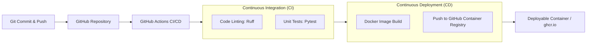

# Pre-trained ML Model Deployment with CI/CD

An end-to-end, production-ready implementation for serving a pre-trained **Hugging Face** Deep Learning model via **FastAPI**, containerized using **Docker**, and continuously integrated and deployed via **GitHub Actions**.

---

## 📌 Architecture & Pipeline



---

## 🚀 Key Features

* **Pre-trained Deep Learning Model:** Uses Hugging Face's `distilbert/distilbert-base-uncased-finetuned-sst-2-english` for high-throughput, low-latency sentiment analysis.
* **Modern API Framework:** Powered by **FastAPI** with automatic OpenAPI/Swagger documentation (`/docs`), Pydantic v2 data validation, and asynchronous handlers.
* **Automated CI/CD Pipeline:** Configured with **GitHub Actions**:
  * **Continuous Integration (CI):** Code linting (`ruff`) and automated unit testing (`pytest`).
  * **Continuous Delivery/Deployment (CD):** Builds a lightweight, production-grade Docker image and automatically publishes it to the GitHub Container Registry (`ghcr.io`).
* **Optimized Dockerfile:**
  * Uses `python:3.11-slim` with CPU-optimized PyTorch wheels.
  * Pre-caches model weights during image build for zero cold-start delay.
  * Runs as a secure, non-root user (`appuser`).
  * Built-in Docker `HEALTHCHECK`.

---

## 📁 Repository Structure

```
├── .github/
│   └── workflows/
│       └── ci-cd.yml          # GitHub Actions CI/CD workflow
├── app/
│   ├── __init__.py
│   ├── config.py              # Application settings & environment variables
│   ├── main.py                # FastAPI endpoints & lifecycle
│   ├── model.py               # Hugging Face model loading and inference logic
│   └── schemas.py             # Pydantic request & response schemas
├── tests/
│   ├── __init__.py
│   └── test_api.py            # Unit and endpoint validation tests
├── .dockerignore
├── .gitignore
├── Dockerfile                 # Production-ready Docker container specification
├── requirements.txt           # Production dependencies
├── requirements-test.txt      # Testing and linting tools
└── README.md
```

---

## 🛠️ Local Development Setup

### 1. Clone the Repository
```bash
git clone https://github.com/SadiaRahman30/Thesis-Task-2.git
cd Thesis-Task-2
```

### 2. Create and Activate a Virtual Environment
```bash
python3 -m venv venv
source venv/bin/activate    # On Windows: venv\Scripts\activate
```

### 3. Install Dependencies
```bash
pip install -r requirements.txt
pip install -r requirements-test.txt
```

### 4. Run the Application Locally
```bash
uvicorn app.main:app --reload --host 0.0.0.0 --port 8000
```
Interactive API documentation will be available at: [http://localhost:8000/docs](http://localhost:8000/docs)

### 5. Run Tests and Linting
```bash
# Run code linting
ruff check .

# Run test suite
pytest -v tests/
```

---

## 🐳 Running with Docker

### 1. Build the Docker Image
```bash
docker build -t thesis-ml-api .
```

### 2. Run the Container
```bash
docker run -d -p 8000:8000 --name ml-api thesis-ml-api
```

### 3. Check Container Health
```bash
curl http://localhost:8000/health
```

---

## 📡 API Endpoints & Examples

### 1. Health Check
* **Endpoint:** `GET /health`
* **Response:**
```json
{
  "status": "healthy",
  "model_name": "distilbert/distilbert-base-uncased-finetuned-sst-2-english",
  "model_loaded": true
}
```

### 2. Single Text Prediction
* **Endpoint:** `POST /predict`
* **Sample Request:**
```bash
curl -X POST "http://localhost:8000/predict" \
     -H "Content-Type: application/json" \
     -d '{"text": "Implementing CI/CD for deep learning models is very effective!"}'
```
* **Sample Response:**
```json
{
  "text": "Implementing CI/CD for deep learning models is very effective!",
  "label": "POSITIVE",
  "score": 0.9998,
  "model_name": "distilbert/distilbert-base-uncased-finetuned-sst-2-english"
}
```

### 3. Batch Predictions
* **Endpoint:** `POST /predict/batch`
* **Sample Request:**
```bash
curl -X POST "http://localhost:8000/predict/batch" \
     -H "Content-Type: application/json" \
     -d '{"texts": ["Everything went smoothly.", "The deployment encountered an error."]}'
```
* **Sample Response:**
```json
{
  "predictions": [
    {
      "text": "Everything went smoothly.",
      "label": "POSITIVE",
      "score": 0.9998,
      "model_name": "distilbert/distilbert-base-uncased-finetuned-sst-2-english"
    },
    {
      "text": "The deployment encountered an error.",
      "label": "NEGATIVE",
      "score": 0.9989,
      "model_name": "distilbert/distilbert-base-uncased-finetuned-sst-2-english"
    }
  ],
  "total_processed": 2
}
```

---

## 🔄 CI/CD Workflow Explanation

1. **Trigger:** Every `git push` or `pull_request` targeting the `main` branch.
2. **CI Stage (`test` job):**
   * Spins up an `ubuntu-latest` virtual environment.
   * Installs Python 3.11 and project dependencies.
   * Executes `ruff` for code standard and quality enforcement.
   * Runs `pytest` to verify API schemas, prediction handlers, and validation rules.
3. **CD Stage (`docker-build` job):**
   * Triggered automatically upon successful completion of the CI stage.
   * Builds the Docker image containing the application and pre-cached model weights.
   * Authenticates with GitHub Container Registry using `${{ secrets.GITHUB_TOKEN }}` (no external credentials required).
   * Pushes the versioned and `latest` tags to `ghcr.io/sadiarahman30/thesis-task-2`.

